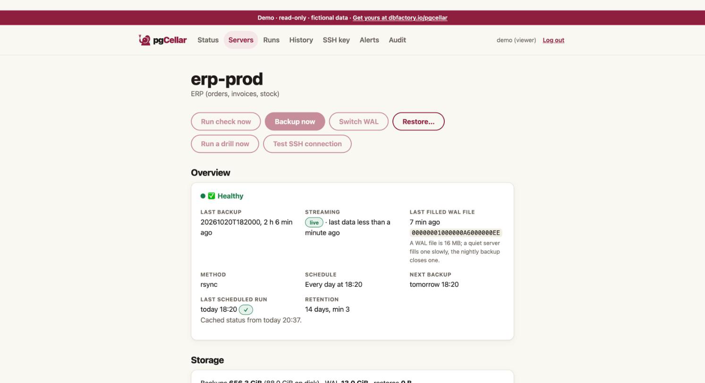
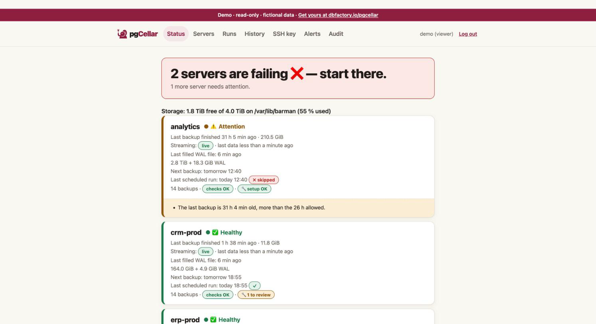

# Getting started

By the end of this chapter you have pgCellar running in Docker, one PostgreSQL server added, a green `barman check`, and a first backup. Count five minutes if PostgreSQL is already prepared. If you still have to create the roles, chapter 3 has the commands.

You need:

- Docker (or Podman) with Compose, on a machine that can reach your PostgreSQL server over the network.
- A PostgreSQL server, version 13 to 18, where you can create two roles and edit `pg_hba.conf`.
- Disk space for the backups. Rule of thumb: one full copy of the database, plus the WAL of the retention period.

## Get the files and the image

```
git clone https://github.com/dbfactory-io/pgcellar.git
cd pgcellar/deploy
mkdir etc-pgcellar etc-barman.d
cp pgcellar.example.yaml etc-pgcellar/pgcellar.yaml
cp .env.example .env && chmod 600 .env
docker compose pull
```

The image is published on GitHub's registry as `ghcr.io/dbfactory-io/pgcellar:<version>`, for linux/amd64 and linux/arm64. `.env` says which version you run: `PGCELLAR_TAG=0.1.0`. Put the latest release there (see the [releases page](https://github.com/dbfactory-io/pgcellar/releases)). Pinning a version means a restart never brings a new one by surprise; moving to the next one is chapter 16. The image contains pgCellar, an unmodified Barman from the PGDG packages, the PostgreSQL client tools, and the PostgreSQL server binaries that restore drills use (chapter 7).

The commands below use a shell variable for the image:

```
IMAGE=ghcr.io/dbfactory-io/pgcellar:$(sed -n 's/^PGCELLAR_TAG=//p' .env)
```

**Building it yourself** (developers, or a custom set of PostgreSQL versions, chapter 7): `docker compose build` builds `deploy/Dockerfile` from the checkout and tags the result with the same name, so the rest of this chapter works unchanged. A self-built image is yours to rebuild at each release: leave the host updater of chapter 16 off, it would replace it with the published image. `make docker` at the root of the repository builds it as `pgcellar:dev` and `ghcr.io/dbfactory-io/pgcellar:dev`.

Two folders are bind-mounted from the host: `etc-pgcellar` (your `pgcellar.yaml`) and `etc-barman.d` (one Barman file per server, written by the console). The container runs as the `barman` user, not as root, so these folders must be writable by that user. Find its uid and set the owner:

```
docker run --rm --entrypoint id "$IMAGE" barman
sudo chown -R 997:997 etc-pgcellar etc-barman.d
```

Use the uid the first command prints (997 in the current image). If you skip this step, pgCellar cannot save its configuration.

## Create the first admin

pgCellar stores a bcrypt hash, never a password. Type the password once and keep the hash:

```
read -rs PW; printf '%s\n' "$PW" | docker run -i --rm "$IMAGE" hash-password
```

The password needs at least 8 characters. The command prints one line that starts with `$2a$` or `$2b$`.

Edit `etc-pgcellar/pgcellar.yaml`:

- In `users:`, replace the fake `password_hash` of `admin` with your hash.
- Set `base_url` to the address people will type, for example `http://backup.example.com:8080`. It is used in links inside alerts and reports.
- Delete the two example entries in `servers:`. You add yours from the console.
- Delete the fake entry in `api_keys:` unless you want it.

Check the file:

```
docker run --rm -v "$PWD/etc-pgcellar:/etc/pgcellar" "$IMAGE" check --config /etc/pgcellar/pgcellar.yaml
```

You want to read `all good` at the end.

## Start

```
docker compose up -d
```

Open `http://localhost:8080` and sign in as `admin`.


The Status page is empty: no server yet. Compose also started a second container, `pgcellar-ssh`. It only matters when a server ships its WAL files with `archive_command` (chapter 4). For streaming you can ignore it.

## Prepare PostgreSQL

pgCellar needs two roles on the PostgreSQL side and two lines in `pg_hba.conf`. Chapter 3 explains each one. Short version, as a superuser on the PostgreSQL server (PostgreSQL 15 or later):

```sql
CREATE ROLE barman LOGIN PASSWORD '...';
CREATE ROLE streaming_barman LOGIN REPLICATION PASSWORD '...';
GRANT pg_read_all_settings, pg_read_all_stats, pg_checkpoint TO barman;
GRANT EXECUTE ON FUNCTION pg_backup_start(text, boolean) TO barman;
GRANT EXECUTE ON FUNCTION pg_backup_stop(boolean) TO barman;
GRANT EXECUTE ON FUNCTION pg_switch_wal() TO barman;
GRANT EXECUTE ON FUNCTION pg_create_restore_point(text) TO barman;
```

In `pg_hba.conf`, with the address pgCellar connects from:

```
host all         barman           10.0.0.5/32 scram-sha-256
host replication streaming_barman 10.0.0.5/32 scram-sha-256
```

Reload PostgreSQL (`SELECT pg_reload_conf();`). Then give the two passwords to the barman user inside the container, in `~/.pgpass`. Barman and pgCellar both read this file, so no password ever sits in a config file:

```
docker compose exec -T pgcellar sh -c 'umask 077; cat >> ~/.pgpass' <<'EOF'
pg-main.example.com:5432:*:barman:THE_BARMAN_PASSWORD
pg-main.example.com:5432:*:streaming_barman:THE_STREAMING_PASSWORD
EOF
```

The file lives in `/var/lib/barman`, which is a volume, so it survives restarts.

## Add the first server

In the console, open **Servers**, then **Add a server**. For a PostgreSQL server reachable over the network:

| Field | Value |
|---|---|
| Name | `pg-main` (lowercase letters, digits, `-`, `_`) |
| Backup method | `postgres (streaming, no SSH)` |
| WAL method | `streaming` |
| Connection string (conninfo) | `host=pg-main.example.com user=barman dbname=postgres port=5432` |
| Streaming connection string | `host=pg-main.example.com user=streaming_barman dbname=postgres port=5432` |
| Replication slot | `barman` |
| Retention | Recovery window 14 days, minimum redundancy 2 |
| Backup schedule | `daily 02:00` |

Press **Create server**. pgCellar writes `/etc/barman.d/pg-main.conf`, adds the server to `pgcellar.yaml`, and commits both to git. The WAL method and the slot are explained in chapters 2 and 4.



## First barman check

On the server page, press **Run check now**. Barman runs its checks and pgCellar explains every line in plain words, with what to do when one fails. Typical first failures: a password missing in `.pgpass`, a missing `pg_hba.conf` line, `wal_level = minimal`. The **Server setup** section reads the PostgreSQL settings and gives the exact `ALTER SYSTEM` commands (chapter 3).

Barman starts its WAL receiver by itself (pgCellar runs `barman cron` every minute). Once every line is green, the server is ready. A new server may say that no WAL has arrived yet; the first backup closes a WAL file and clears that.

## First backup

Press **Backup now**. pgCellar runs `barman backup pg-main`, then forces a WAL switch so the backup can be restored right away. Follow it on the **Runs** page: it shows every command with its output and duration.


When it is done, the server is green on Status and the Timeline shows the first point in time you can restore to.



## Without Docker: the binary under systemd

pgCellar is also one static binary, for linux amd64, linux arm64 and macOS arm64, attached to every [release](https://github.com/dbfactory-io/pgcellar/releases) with `checksums.txt`. It needs a working Barman on the same machine (installed from the PGDG packages, with its `barman` user) and the PostgreSQL client tools. The unit file is `deploy/systemd/pgcellar.service`.

The service runs as `barman`: Barman refuses to run as anyone but its `barman_user`, and the SSH keys pgCellar manages are that user's. The binary lives in `/opt/pgcellar/bin`, a directory owned by `barman`, so that automatic updates can replace it next to itself (chapter 16). As root, from a checkout of the repository (for the example configuration and the unit), with `V` the version you install:

```
V=0.1.0; A=linux_amd64
curl -fLO https://github.com/dbfactory-io/pgcellar/releases/download/v$V/pgcellar_${V}_$A.tar.gz
curl -fLO https://github.com/dbfactory-io/pgcellar/releases/download/v$V/checksums.txt
sha256sum --ignore-missing -c checksums.txt
tar -xzf pgcellar_${V}_$A.tar.gz pgcellar
install -d -o barman -g barman -m 0755 /opt/pgcellar/bin /etc/pgcellar /var/lib/pgcellar
install -o barman -g barman -m 0755 pgcellar /opt/pgcellar/bin/pgcellar
install -o barman -g barman -m 0640 deploy/pgcellar.example.yaml /etc/pgcellar/pgcellar.yaml
install -m 0644 deploy/systemd/pgcellar.service /etc/systemd/system/pgcellar.service
```

Edit `/etc/pgcellar/pgcellar.yaml` as above (admin hash from `/opt/pgcellar/bin/pgcellar hash-password`, `base_url`, no example servers), check it with `sudo -u barman /opt/pgcellar/bin/pgcellar check --config /etc/pgcellar/pgcellar.yaml`, then:

```
systemctl daemon-reload
systemctl enable --now pgcellar
journalctl -u pgcellar -n 20      # "pgcellar 0.1.0 listening on ..."
```

What the unit sets, and why:

- `User=barman`, `Group=barman`.
- `ExecStart=/opt/pgcellar/bin/pgcellar serve --config /etc/pgcellar/pgcellar.yaml`.
- `EnvironmentFile=-/etc/pgcellar/pgcellar.env`: the secrets of the alert channels (chapter 8), mode 0600, never in the YAML.
- `Restart=on-failure`, `RestartSec=5`: a crash restarts the service. After an automatic update these restarts are counted, and the third one rolls back to the previous binary (chapter 16).
- `ProtectSystem=full`, `ProtectHome=read-only`, `NoNewPrivileges=true`, and `ReadWritePaths=/opt/pgcellar/bin /var/lib/pgcellar /etc/pgcellar /etc/barman.d /var/lib/barman`: the only places it writes.

Without automatic updates the binary may stay root-owned, anywhere; change `ExecStart` to match. The SSH companion is a container of the Docker setup only: with a binary install, `archive_command` (chapter 4) needs an sshd on the host that lets the `barman` user in, and `ssh_port` set to its port.

## Where to go next

- Put the schedule in place: [Backups, schedules and retention](05-backups-schedules-retention.md).
- Plan the first drill, so the backup is proven: [Restore drills and reports](07-restore-drills-and-reports.md).
- Set up alerts so you hear about problems: [Alerts](08-alerts.md).
- Try pgCellar without any PostgreSQL: `make demo` in the repository starts it on fictional data (login `demo` / `demo`). A public demo runs at https://demo.pgcellar.dbfactory.io.
