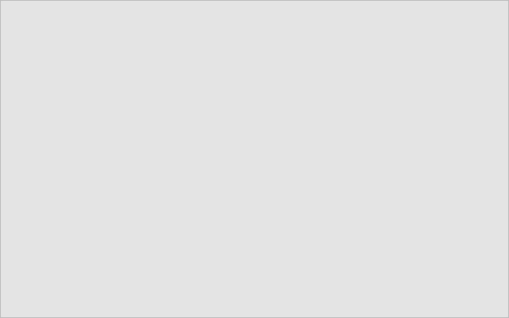

# Preparing a PostgreSQL server

pgCellar never changes your PostgreSQL server. You prepare it once, with the commands in this chapter, and the **Server setup** section of the server page checks that you did it right and keeps checking. Every command below is the one pgCellar prints in its own fix column, so you can also copy it from the console.



## Two roles

Barman uses two connections, so it uses two roles.

| Role | Used for | Needs |
|---|---|---|
| `barman` | Checks, metadata, starting and stopping a backup, switching WAL | `LOGIN`, the grants below |
| `streaming_barman` | `pg_basebackup` and the WAL stream | `LOGIN REPLICATION` |

You can use other names. The names go in the two connection strings of the server (chapter 4).

On PostgreSQL 15 and later, as a superuser:

```sql
CREATE ROLE barman LOGIN PASSWORD '...';
CREATE ROLE streaming_barman LOGIN REPLICATION PASSWORD '...';

GRANT pg_read_all_settings, pg_read_all_stats, pg_checkpoint TO barman;
GRANT EXECUTE ON FUNCTION pg_backup_start(text, boolean) TO barman;
GRANT EXECUTE ON FUNCTION pg_backup_stop(boolean) TO barman;
GRANT EXECUTE ON FUNCTION pg_switch_wal() TO barman;
GRANT EXECUTE ON FUNCTION pg_create_restore_point(text) TO barman;
```

In `psql`, use `\password barman` instead of typing the password in the statement, so it does not land in your shell history or the server log.

On PostgreSQL 13 and 14 the predefined role `pg_checkpoint` does not exist and the backup functions have other names. Grant `pg_monitor` instead, and:

```sql
GRANT pg_monitor TO barman;
GRANT EXECUTE ON FUNCTION pg_start_backup(text, boolean, boolean) TO barman;
GRANT EXECUTE ON FUNCTION pg_stop_backup() TO barman;
GRANT EXECUTE ON FUNCTION pg_stop_backup(boolean, boolean) TO barman;
GRANT EXECUTE ON FUNCTION pg_switch_wal() TO barman;
GRANT EXECUTE ON FUNCTION pg_create_restore_point(text) TO barman;
```

A superuser also works for `barman`. It is simpler and it is more power than the job needs; prefer the grants.

The role must be allowed to read `archive_command`. `pg_read_all_settings` (or `pg_monitor`) does that. Without it PostgreSQL answers `<insufficient privilege>` and pgCellar shows an info line asking you to grant the role.

## pg_hba.conf

`all` does not match replication connections, so the replication role needs a line of its own with the word `replication` as database:

```
host all         barman           10.0.0.5/32 scram-sha-256
host replication streaming_barman 10.0.0.5/32 scram-sha-256
```

Replace the address with the one PostgreSQL sees. If a proxy or a relay sits between pgCellar and PostgreSQL, it is the proxy's address, not the address of the pgCellar host. When in doubt, try to connect and read the PostgreSQL log: the refusal names the exact address (`no pg_hba.conf entry for host "172.27.0.4", user "barman"`).

Put the lines before any broader rule that would match first (a `trust` line, for example), then reload:

```sql
SELECT pg_reload_conf();
```

Check how PostgreSQL parsed them:

```sql
SELECT line_number, type, database, user_name, address, auth_method, error
  FROM pg_hba_file_rules
 WHERE 'barman' = ANY (user_name) OR 'streaming_barman' = ANY (user_name);
```

The `error` column must be empty.

## Passwords: ~/.pgpass

pgCellar and Barman read passwords from `~/.pgpass` of the barman user (`/var/lib/barman/.pgpass` in the image), mode 0600, one line per connection:

```
pg-main.example.com:5432:*:barman:THE_BARMAN_PASSWORD
pg-main.example.com:5432:*:streaming_barman:THE_STREAMING_PASSWORD
```

pgCellar drops any `password=` from a connection string before it runs `psql`, and never puts a password on a command line. Put the password in `.pgpass` and not in the connection string.

## The settings Server setup checks

pgCellar reads these settings with one read-only query on `pg_settings`, through `psql`, using the `conninfo` of the server. The first read happens after the first status refresh; then every `setup_interval` (30 minutes by default), and again each time you press **Run check now**.

A check is `ok`, `info`, `warning` or `error`. An **error** means Barman will fail or a backup cannot be trusted, and it turns the server red or orange in Status. A **warning** is advice and never changes the colour of a server.

| Setting | Wants | Level when wrong | Needs |
|---|---|---|---|
| `wal_level` | `replica` or `logical` | error | restart |
| `max_wal_senders` | 2 or more | error | restart |
| `max_replication_slots` | 1 or more when the server has a `slot_name` | error | restart |
| `archive_mode` | `on` or `always`, only when WAL goes by `archive_command` | error | restart |
| `archive_command` | `barman-wal-archive ...`, only when WAL goes by `archive_command` | error | reload |
| `archive_timeout` | more than 0, for example `1h` | warning | reload |
| `max_slot_wal_keep_size` | not `-1` when a slot is used, for example `2GB` | warning | reload |
| `full_page_writes` | `on` | error | reload |
| `data_checksums` | `on` | warning | not a setting, see below |
| client tools version | `pg_basebackup` at least as recent as the server | error | image change |
| `wal_compression`, `summarize_wal` | information only | info | |

Settings that do not exist in the version of your server are skipped.

Three more lines come from `barman check`, without any new query: **Streaming access**, **Role privileges** and **Replication slot**. When streaming access fails, the fix shows the `pg_hba.conf` line to add, with your streaming user in it. For servers using `archive_command`, Barman's own verdicts on `wal_archive`, `archive_command` and `archive_mode` are shown too.

If pgCellar cannot read the settings at all (no network, no password in `.pgpass`), the section shows one error line: "Could not read the server settings", with the reason. That line does not change the health of the server, because Barman's own checks already tell you whether the server is reachable.

### The fixes, one by one

Each fix is plain SQL. A parameter that needs a restart says so; apply it in a maintenance window.

**wal_level** (restart):

```sql
ALTER SYSTEM SET wal_level = 'replica';
```

**max_wal_senders** (restart). Barman streams WAL over one connection and takes the base backup over another:

```sql
ALTER SYSTEM SET max_wal_senders = 10;
```

**max_replication_slots** (restart):

```sql
ALTER SYSTEM SET max_replication_slots = 10;
```

**archive_mode** (restart), when WAL goes by `archive_command`:

```sql
ALTER SYSTEM SET archive_mode = 'on';
```

**archive_command** (reload). The command comes from the `ssh_host` and `ssh_port` of `pgcellar.yaml` and the name of the server:

```sql
ALTER SYSTEM SET archive_command = 'barman-wal-archive --port 2222 backup.example.com pg-main %p';
SELECT pg_reload_conf();
```

`barman-wal-archive` comes from the `barman-cli` package on the PostgreSQL host. The postgres user must have an SSH key that pgCellar has authorised (chapter 4). pgCellar cannot test this command from its side. The proof is to press **Switch WAL** on the server page and look at the WAL archive check.

**archive_timeout** (reload). On a quiet database a 16 MB file fills rarely, so the recovery point can be hours old. Closing a file at least once an hour bounds it:

```sql
ALTER SYSTEM SET archive_timeout = '1h';
SELECT pg_reload_conf();
```

**max_slot_wal_keep_size** (reload). If the backup host is down for long, the slot holds WAL and the PostgreSQL disk can fill. Cap it:

```sql
ALTER SYSTEM SET max_slot_wal_keep_size = '2GB';
SELECT pg_reload_conf();
```

Choose a value larger than the WAL your server writes during the longest outage you want to survive. If the cap is hit, PostgreSQL invalidates the slot and Barman loses the chain: you take a new backup. That is a better failure than a full production disk.

**full_page_writes** (reload). It should never be off for a server you back up:

```sql
ALTER SYSTEM SET full_page_writes = on;
SELECT pg_reload_conf();
```

**data_checksums.** This is not a parameter. Enable it when the cluster is created (`initdb --data-checksums`), or on a stopped cluster:

```
pg_checksums --enable -D /var/lib/postgresql/16/main
```

then start PostgreSQL again. Without checksums a damaged data page goes unnoticed, in the backup as well, and a restore drill cannot tell. The check is a warning, and a very good idea.

**Client tools version.** `pg_basebackup` must be at least as recent as the server. The image ships the PostgreSQL 18 client, which talks to 13 through 18. If you replace the client, point `path_prefix` in the server file to the directory with the right binaries.

## Quick manual test

From the pgCellar host, before you add the server:

```
docker compose exec pgcellar psql "host=pg-main.example.com user=barman dbname=postgres" -c "select 1"
docker compose exec pgcellar psql "host=pg-main.example.com user=streaming_barman dbname=postgres replication=true" -c "IDENTIFY_SYSTEM"
```

Both must answer without asking for a password. If they do, add the server in the console.
