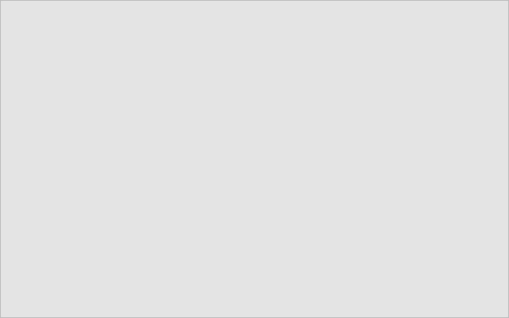

# Backups, schedules and retention

## Backup now

On a server page, **Backup now** (operator role) starts a backup. The same thing from the API:

```
curl -X POST -H "Authorization: Bearer $KEY" http://localhost:8080/api/v1/servers/pg-main/backup
```

pgCellar runs two Barman commands, in this order:

```
barman backup pg-main
barman switch-wal --force --archive pg-main
```

It never uses `barman backup --wait`. On a quiet database the end of the backup sits in a WAL segment that is still being written, and `--wait` blocks until 16 MB of WAL appear or someone forces a switch. A backup that took 11 seconds could then wait 15 minutes. The forced switch closes that segment so the backup is restorable at once (chapter 13).

Everything runs in the background. The run appears on **Runs** with the output of each command, its exit code and its duration. A closed browser tab does not interrupt it. Only one backup per server runs at a time.

**Runs lists only what was started from pgCellar** (the console, the scheduler or the API). A backup taken with the `barman` command or with a host cron does not appear there; it does appear in the **Backups** list of the server page, which comes from Barman itself.


## Schedules

You do not need cron on the host. pgCellar runs the schedules itself. The schedule of a server is one line:

```yaml
servers:
  - name: pg-main
    schedule:
      backup: "daily 02:00"
      enabled: true
```

You can also set it in the server form (field **Backup schedule**, checkbox **Enabled**).

### Syntax

| Text | Means |
|---|---|
| `daily 02:00` | Every day at 02:00 |
| `weekly sun 03:00` | Every Sunday at 03:00. Days: `mon tue wed thu fri sat sun` |
| `hourly` | At minute 0 of every hour |
| `every 6 hours` | Every 6 hours, at minute 0 (N from 1 to 23) |
| `30 1 * * 1-5` | A 5-field cron expression: minute, hour, day of month, month, day of week |

Case and extra spaces do not matter. Times are 24 hours. A raw cron expression accepts lists (`1,15`), ranges (`1-5`) and steps (`*/10`). pgCellar checks it when you save; a typo is refused with a message.

**Time zone.** Schedules run in the time zone of the pgCellar process, which is the `TZ` environment variable of the container. The Compose file sets `TZ: Europe/Brussels`; change it to yours. The container default is UTC.

`schedule.enabled` absent means: on, as soon as a `backup` schedule is written. Set `enabled: false` to pause a server's schedule and keep the line.

### The scheduler

The block `scheduler:` governs all schedules:

```yaml
scheduler:
  enabled: true     # false = pgCellar starts nothing by itself
  catch_up: 6h      # a due time missed while pgCellar was stopped still runs if younger than this
  parallel: 1       # backups running at once, all servers together
```

How it behaves:

- It wakes every 30 seconds and starts every backup whose due time has passed.
- A due time runs once. The result of the last handled due time is stored, so a restart neither replays nor forgets it.
- **Catch-up.** If pgCellar was stopped at 02:00 and starts at 03:30, the 02:00 backup still runs, because it is younger than `catch_up` (6 hours). Older than that, it is dropped. Several missed due times collapse into the latest one. `catch_up: 0` turns catch-up off. A server you add later, or a schedule you just changed, counts from now: nothing is run for a past that was not missed.
- **Busy.** If a manual backup is running on the same server when a due time arrives, the scheduled one is recorded as *skipped* and not retried. If all `parallel` slots are taken, the due time waits for the next tick and keeps its place.
- `parallel` counts every backup in progress, manual ones included, because it protects the Barman host.
- A skipped run is announced by an alert (chapter 8).

The server page shows **Next backup** and **Last scheduled run**.

## Retention

Retention decides how long backups and their WAL are kept. Barman applies it, not pgCellar: Barman deletes obsolete backups at the end of each backup and during `barman cron`. pgCellar never runs `barman delete` for retention.

The server form has three fields:

| Field | Barman line | Meaning |
|---|---|---|
| Recovery window (days) | `retention_policy = RECOVERY WINDOW OF 14 DAYS` | Keep enough backups to restore to any moment in the last 14 days |
| Redundancy (backups kept) | `retention_policy = REDUNDANCY 3` | Keep the 3 most recent backups |
| Minimum redundancy | `minimum_redundancy = 2` | Never delete below 2 backups, whatever the policy says |

Use either a window or a redundancy, not both. The form and `pgcellar check` refuse both. 0 means "not set".

Advice:

- A **recovery window** matches how people think: "I want to go back 14 days". Barman keeps the newest backup older than the window, so that the whole window is restorable.
- Always set a **minimum redundancy** of at least 2. If backups start failing, retention would otherwise happily delete the last good ones.

The values are written to the Barman file when the form is saved. `retention_policy_mode` is left out, since Barman's default (`auto`) is what you want.

The Timeline marks the retention window on its axis; the Storage section (chapter 11) shows what the retention costs on disk.



## Deleting a backup

On the server page, each complete backup has a **Delete…** button (admin). The row turns into a sentence with two buttons: **Delete** and **Keep it**. It runs:

```
barman delete pg-main 20261020T020001
```

pgCellar does not second-guess Barman. If the delete would go below `minimum_redundancy`, Barman refuses and its message comes back unchanged (HTTP 409 in the API). The backup id must look like `20261020T020001`. The command runs even if you close the tab, and it is audited as `backup.delete`.

The API form:

```
curl -X DELETE -H "Authorization: Bearer $KEY" http://localhost:8080/api/v1/servers/pg-main/backups/20261020T020001
```

Deleting is final. Deleting a backup also lets Barman remove the WAL no remaining backup needs.

## Reading the result

A server is **red** when a check fails, there is no good backup, or the last backup is older than twice the limit; **orange** for any other problem (last attempt failed, backup older than `alerts.max_backup_age`, WAL not received for too long). The limits are in `alerts:` (26 hours for a backup, 24 hours for WAL, when you set nothing). Red means "act now"; orange means "look at it today".
