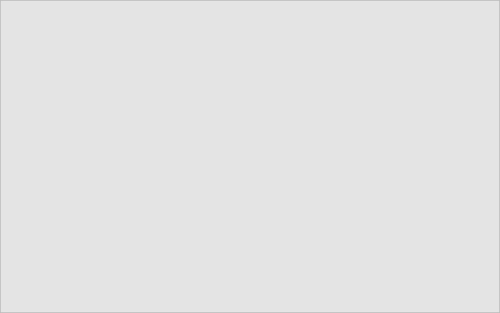

# Restores and point-in-time recovery

A restore in pgCellar writes a ready-to-start PostgreSQL data directory from a backup, replaying archived WAL up to the target you choose. **Nothing is touched on the production server.** The data directory lands in a folder on the pgCellar host. What you do with it next, you decide: inspect it, copy a table out of it, or replace the broken production directory.



## Before you restore: read the Timeline

The **Timeline** section of the server page draws what you can restore to: the full backups, the WAL that links them, the retention window, the holes. Two sentences matter:

- **You can go back to**: the earliest point in time. It is the end of the oldest backup whose WAL chain is unbroken, segment by segment, up to the newest archived WAL.
- **Latest**: the last data received when streaming is live, otherwise the arrival time of the last completed WAL file.

A hole in the WAL (a missing segment number between two files of the same timeline) is drawn in red, with the number of files missing. A backup before a hole cannot be used for a target after the hole.

The Timeline is read from Barman's own files, in a few milliseconds. No Barman command runs to draw it. The same data is at `GET /api/v1/servers/{name}/timeline`.

## Starting a restore

On the server page, next to a complete backup, press **Restore…** (operator role). The Restore page asks for:

| Choice | Meaning |
|---|---|
| Backup | A backup with status DONE. Failed or running backups cannot be restored. |
| Target: **Latest possible** | Replay all the WAL Barman holds. |
| Target: **End of this backup** | Stop as soon as the data is consistent. No WAL after that. |
| Target: **Point in time** | Stop at the date and time you give. |
| Also build a `.tar.gz` I can download | Packs the directory after the restore. Slower, needs room for a second copy. |

For a point in time, type a date and time. Without a zone it is read in the time zone of the server. With a zone, it is exact:

```
2026-10-20 14:30:00+02:00
```

RFC 3339 (`2026-10-20T14:30:00+02:00`) works too. The target must not be before the end of the chosen backup; the form says so in a sentence. The other way, a target after the last WAL, is not checked: Barman reports the missing WAL.

The "End of this backup" target uses `--target-immediate` and not a target time equal to the end of the backup. A target time needs a WAL record dated after it, and a quiet database may never produce one.

The same operation from the API (the call returns at once; follow the run):

```
curl -X POST -H "Authorization: Bearer $KEY" -H "Content-Type: application/json" \
  -d '{"backup_id":"20261020T020001","target":"time","target_time":"2026-10-20 14:30:00+02:00","archive":true}' \
  http://localhost:8080/api/v1/servers/pg-main/recoveries
```

The answer is `202` with a `run_id`. `GET /api/v1/runs/{run_id}` shows the progress and the Barman output; `GET /api/v1/servers/pg-main/recoveries` lists the results.

## Where the restore goes

```
<recoveries.dir>/<server>/<backup id>-<timestamp>
```

for example `/var/lib/pgcellar/recoveries/pg-main/20261020T020001-20261020T153012`. The default `recoveries.dir` is `/var/lib/pgcellar/recoveries`. This folder is inside the container. **Map it to the Docker host** or you will not be able to read what you restored. In `docker-compose.yml`, replace the named volume with a bind mount owned by the barman uid:

```yaml
    volumes:
      - /srv/pgcellar/recoveries:/var/lib/pgcellar/recoveries
```

```
sudo mkdir -p /srv/pgcellar/recoveries && sudo chown 997:997 /srv/pgcellar/recoveries
```

A restore is as big as the database, so put it on a disk with room. The Storage section counts restores in what it reports.

Rules about that path, which protect your disks: it is always two levels deep under `recoveries.dir`, built only from a validated server name and a backup id, and checked again before every delete, purge and download. A database row that points elsewhere is refused, not followed.

## The `.tar.gz`

If you ticked the box, pgCellar builds `<directory>.tar.gz` next to the directory after the restore, streaming (no file loaded in memory), written as `.partial` and renamed when complete. The **Download .tar.gz** button (operator role) serves it with byte ranges, so a download can resume.

Limits:

- Above `recoveries.max_download_bytes` (2 GiB by default; `0` = no limit) there is no download link, only the path: read it on the host.
- If the restore succeeded but the archive failed, the directory is kept and the run is marked failed with the reason.
- A failed `barman recover` removes its half-written directory.

## Using the restored directory

The result is a PostgreSQL data directory, not a running server. Start a server **of the same major version** on it:

```
cd /srv/pgcellar/recoveries/pg-main/20261020T020001-20261020T153012
ls                    # PG_VERSION, base, pg_wal, postgresql.auto.conf, recovery.signal ...
cat PG_VERSION
```

Barman wrote the recovery settings (the target) into `postgresql.auto.conf` and created `recovery.signal`; the WAL it needs is copied into `pg_wal`. Start PostgreSQL on that directory, on a free port, and let it replay. When it reaches the target it promotes itself and accepts connections. Typical way to inspect it:

```
docker run --rm -v "$PWD":/var/lib/postgresql/data -p 55432:5432 postgres:16
```

Use the image of your own major version, and check that the user in the container owns the files.

To restore *over* production, stop production, keep the damaged directory aside, put the restored one in its place, fix ownership and permissions, and start. That step is yours: pgCellar deliberately never writes to a production host.

## Retention of restores

Restores older than `recoveries.keep_days` (7 by default; `0` keeps everything) are removed by a daily pass: directory, archive and record. An admin can also delete one by hand (**Delete** in the Recoveries list, or `DELETE /api/v1/recoveries/{id}`). Deletion is audited.

Roles: an operator starts a restore and downloads the archive; an admin deletes. A viewer sees the list and the paths but cannot download, because the archive is a full copy of the database and more sensitive than a backup list. Every download, start, delete and purge is audited (`recover.start`, `recovery.download`, `recovery.delete`, `recovery.purge`).

## Limits

- Restore is **local**: `barman recover` writes to a folder on the pgCellar host. There is no "restore to a remote host" here. Copy the directory yourself.
- One restore per server at a time.
- Only a backup with status DONE can be restored.
- Timeline switches (after a failover) are followed when the history file is present. Without a `.history` file the fork point is unknown, and the chain is treated as broken.
- A backup of an old major version cannot start on a newer PostgreSQL. Use the same major version as the source.
- Restoring does not prove that a *whole system* works (extensions, configuration files outside the data directory, roles). A restore drill does the next best thing, automatically (chapter 7).
