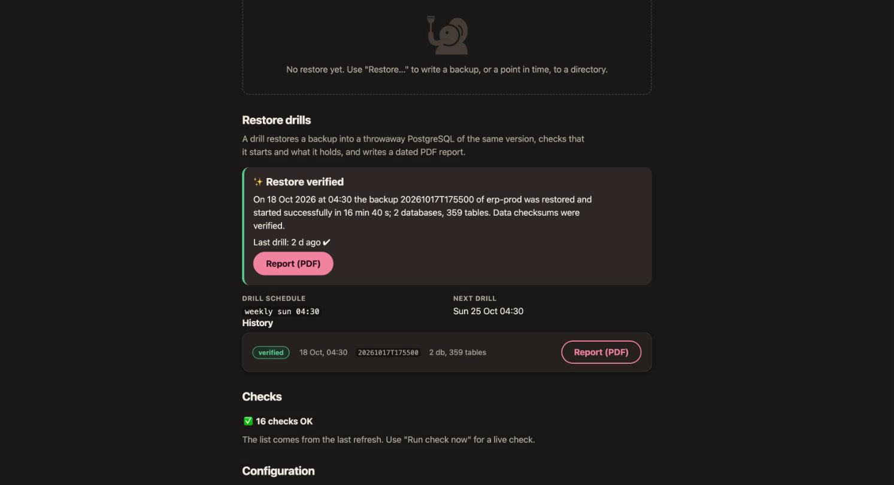

# Restore drills and reports

A backup you have not restored is a hope. A restore drill is pgCellar restoring one of your backups for real, every week, on its own, starting the copy, looking inside it, and writing a dated PDF that you can hand to an auditor.



## What a drill does, step by step

A drill never touches the production server. It works on a copy of a backup, under `recoveries.dir`. One drill at a time, never during a backup of the same server (a backup of that server waits while its drill runs).

| Step | What happens |
|---|---|
| 1. Restore the backup | `barman recover` into `<recoveries.dir>/<server>/drill-<timestamp>/`. The latest backup with status DONE, target latest. |
| 2. Find the PostgreSQL version | Reads `PG_VERSION` of the restored directory to choose the binaries of the same major version. |
| 3. Prepare the throwaway copy | Appends a few settings to the `postgresql.auto.conf` Barman wrote (see below). |
| 4. Start PostgreSQL | `pg_ctl start -w -t 300` from `/usr/lib/postgresql/<major>/bin`, on a free port between 54400 and 54499. |
| 5. Wait for the end of the recovery | `pg_isready` until the copy accepts connections, then `SELECT pg_is_in_recovery()` must answer `f`. Limit: `drills.recovery_timeout`. |
| 6. Look inside the databases | Runs queries: `version()`, the replay LSN, every non-template database with its size and its number of tables. |
| 7. Stop PostgreSQL | `pg_ctl stop`, fast, then immediate if needed. |
| 8. Verify the data checksums | `pg_checksums --check` on the stopped copy, only if the cluster uses checksums. Skipped, with the reason, if not. |
| 9. Clean up | Removes the directory, unless it is the last good drill and `keep_last` is on. |

Why checksums come after the stop: `pg_checksums --check` refuses a cluster that was not shut down cleanly, and the control file of a restored base backup says "in production" until PostgreSQL has stopped once.

**What the throwaway copy is configured with.** It listens on `127.0.0.1` only, with a trust rule on its own socket and TCP rejected. It runs with `archive_mode = off`, `max_connections = 10`, `shared_buffers = 64MB`, `max_wal_senders = 0`, `autovacuum = off`, `logging_collector = off`, `ssl = off`, `jit = off`, `hot_standby = off`, an empty `shared_preload_libraries` (so an extension library missing from the image cannot stop the check), and the locale messages set to `C`. None of this changes your data; it only lets a small copy start anywhere.

**What the check proves, and what it does not.** It proves that the backup restores, the WAL replays, PostgreSQL starts on it, the databases are there, their tables can be counted, and, when checksums are on, no page is damaged. With `drills.verify_tables: true` it also runs `SELECT count(*)` on every table (slow on large databases) and sums the rows per database. It does not compare the data with the source, and it does not test your application. A source that needs an extension library to replay WAL is started without it and is not tested for it. Configuration files outside the data directory (Debian's `/etc/postgresql`) are not handled.

A drill can also restore from the off-site copy instead of this host (`drills.source: vault`, or the button **Drill from the off-site copy**): it fetches the backup from the bucket with restic first, and the report says so. See chapter 17.

When a step fails, the report keeps the earlier steps, the error text and the last 25 lines of the PostgreSQL log of the copy. pgCellar still stops the copy and removes the directory.

## Switching drills on

Drills are scheduled per server, in `pgcellar.yaml`:

```yaml
servers:
  - name: pg-main
    drills:
      schedule: "weekly sun 04:30"   # same syntax as the backup schedule; empty = none

drills:
  enabled: true          # false stops the scheduled drills; manual ones stay possible. Absent = true
  timeout: 30m           # a whole drill, restore included
  recovery_timeout: 10m  # wait for the copy to finish replaying WAL
  keep_last: true        # keep the data directory of the last good drill. Absent = true
  verify_tables: false   # true = SELECT count(*) on every table
  max_age: 192h          # the server turns orange when the last good drill is older (8 days)
  bin_dir: /usr/lib/postgresql
```

Do not write `enabled: false` unless you mean it; the absent key already means "on". A drill schedule only takes effect when the server has one.

Choose a time after the nightly backup. The schedule uses the same syntax as backups (chapter 5). The drill schedule is edited in `pgcellar.yaml`, not in the server form; the form keeps it when you save.

To run one now: **Run a drill now** in the Restore drills section (operator), or:

```
curl -X POST -H "Authorization: Bearer $KEY" http://localhost:8080/api/v1/servers/pg-main/drills
```

The body is optional. By default the drill uses the latest DONE backup and target `latest`. You can give `backup_id`, `target` (`latest`, `backup_end`, `time`) and `target_time`. The call answers `202` with a `run_id`; the run output lists every command with its answer. It returns `409` while another drill or a backup of the same server runs.

A server turns **orange** in Status when its last drill failed, or when no drill has passed for `max_age`. A server that never had a drill is not orange: its first due time is not late. Metrics: `pgcellar_last_drill_ok{server}` and `pgcellar_last_drill_age_seconds{server}`.

## What the image must contain

A drill starts the restored copy with the PostgreSQL **server** binaries of the same major version as the source. The Docker image installs them for the versions in the build argument `PG_MAJORS` (default `16 17 18`), as binaries only: no cluster, no service. If the source's major version is not there, the drill fails at step 2 with "PostgreSQL <major> binaries are not in this image". The published image has the default; for another set, build your own from the checkout, in `deploy/`:

```
docker compose build --build-arg PG_MAJORS="15 16 17"
```

The result takes the name of the image in the compose file, so `docker compose up -d` runs it. Leave the host updater of chapter 16 off with a self-built image (it would replace it with the published one), and rebuild it at each release.

Sizes, measured on arm64 (uncompressed): 312 MB without the server binaries, 639 MB with `16 17 18`. A single version is about 170 MB more than none. Fewer versions, smaller image.

### Locales

A restored data directory keeps the collation and ctype locale of its source, and PostgreSQL refuses to start on a locale the system does not have. A source cluster created in a `postgres:16-alpine` or `postgres:16` container is typically `en_US.utf8`.

The image generates a fixed list from the build argument `PG_LOCALES`: `C.UTF-8 en_US.UTF-8 en_GB.UTF-8 fr_FR.UTF-8 fr_BE.UTF-8 nl_NL.UTF-8 nl_BE.UTF-8 de_DE.UTF-8 es_ES.UTF-8 it_IT.UTF-8 pt_BR.UTF-8`. That adds about 23 MB. If your cluster uses another one, add it (name as in `/usr/share/i18n/SUPPORTED`) and rebuild:

```
docker compose build --build-arg PG_LOCALES="C.UTF-8 en_US.UTF-8 pl_PL.UTF-8"
```

A start that fails on a locale is reported as: "The cluster uses locale X, which this image does not have. Rebuild with PG_LOCALES including Y (see deploy/Dockerfile)." Find your cluster's locale with `SELECT datcollate, datctype FROM pg_database;`.

## Disk and memory

A drill needs room for the database plus its WAL under `recoveries.dir`. With `keep_last: true` the last good copy of each server stays there, so you can look at it; `du -sh <recoveries.dir>/*/drill-*` tells what it costs. Set `keep_last: false` if the disk is tight.

RAM: a drill adds some tens of MB (the copy runs with `shared_buffers = 64MB`). Drills never overlap.

Only the last **successful** copy is ever kept: the previous kept copy is removed when a new drill passes, and a failed drill never touches it. A `drill-*` directory that no record points to and that is older than a day (a restart during a drill) is removed by the daily purge. Records and reports are never purged; they weigh a few KB each.

## The PDF report

Every drill writes a PDF, passed or failed:

```
<recoveries.dir>/<server>/reports/drill-<timestamp>.pdf
```

It opens from the server page (**Report (PDF)**, operator role), from `GET /api/v1/drills/{id}/report`, and it is on the host if you mapped the folder. It contains:

- a banner, **RESTORE VERIFIED** or **FAILED**, and the verdict in one sentence;
- the drill in a table: server, source backup, recovery target, date, duration, PostgreSQL version, WAL position reached (LSN), restored size, data checksums, who started it, and the run number;
- the steps, with the result and the duration of each, and a note (the failing step and the error text when there is one);
- the databases found in the copy, with size and number of tables, and the rows counted when `verify_tables` is on;
- for a failed drill, "What went wrong": the error and the end of the PostgreSQL log of the copy;
- a closing paragraph that says what the report records, and a footer with the fingerprint.

The report is written by pgCellar's own small PDF writer, with no dependency. Each file is read back the way a viewer would start it (header, cross-reference table, every offset and stream length) before it is stored.

### The fingerprint

The footer carries **SHA-256 of the report content**: the hash of the text of the body, in the order it is drawn. It is also stored with the drill record, and returned by the API (`details.fingerprint`). To check a report, compute the hash of its text and compare it with the record. This detects a *changed text*. It does not detect a changed layout, and it is not a digital signature: anyone with write access to the report folder could produce a new file and a new hash. If you need non-repudiation, copy the PDF and the fingerprint to a system you do not control, and sign them there.

## Reading a failed drill

The server page shows the last result large ("Restore verified" or "Restore drill failed"), the history, and the failing step. The run behind it holds the whole journal: each command with its output, step by step. Chapter 13 lists the usual causes: a missing locale, a missing major version, a `noexec` temporary directory, a source that needs an extension.
