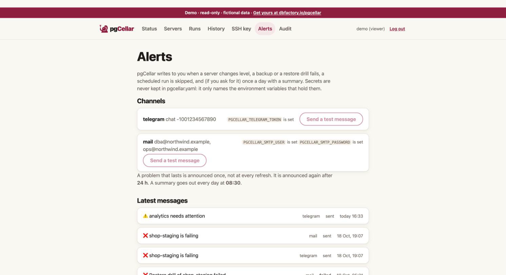

# Alerts

pgCellar writes to you when something needs a human, and keeps quiet otherwise. Three channels: Telegram, mail and a signed webhook. Use one, two or all three.



## What triggers a message

| Kind | When | Example title |
|---|---|---|
| Level change | A server goes from healthy to attention or failing, or from attention to failing and back | `pg-main is failing`, `pg-main needs attention` |
| Resolved | A server is healthy again (one message) | `pg-main is healthy again` |
| Reminder | A problem that lasts, after `repeat_every` | `pg-main is still failing (for 2 days)` |
| Backup failed | A backup run ended with an exit code other than 0, scheduled or manual | `Backup of pg-main failed` |
| Drill failed | A restore drill failed | `Restore drill of pg-main failed` |
| Drill passed | Only with `on_drill_success: true` | `Restore drill of pg-main passed` |
| Skipped | A scheduled backup or drill could not start | `Scheduled backup of pg-main did not run` |
| Daily summary | Once a day, if you ask for it | `Everything is fine` |

The level of a server is the one the Status page shows. Storage thresholds, old backups, a stopped WAL receiver, a failed or too-old drill all change it, so they need no message of their own: the level change covers them.

## Configure the channels

Secrets never go in `pgcellar.yaml`. The file names the **environment variables** that hold them; you set those variables in the container.

```yaml
alerts:
  max_backup_age: 26h
  repeat_every: 24h
  on_drill_success: false
  daily_summary: "08:30"
  telegram:
    token_env: PGCELLAR_TELEGRAM_TOKEN
    chat_id: "-1001234567890"
  mail:
    host: smtp.example.com
    port: 587
    starttls: true
    from: pgcellar@example.com
    to: [dba@example.com]
    user_env: PGCELLAR_SMTP_USER
    password_env: PGCELLAR_SMTP_PASSWORD
  webhook:
    url: https://hooks.example.com/pgcellar
    secret_env: PGCELLAR_WEBHOOK_SECRET
```

In `docker-compose.yml`, under `environment:` of the `pgcellar` service:

```yaml
    environment:
      TZ: Europe/Brussels
      PGCELLAR_TELEGRAM_TOKEN: "123456:ABC..."
      PGCELLAR_SMTP_USER: "pgcellar@example.com"
      PGCELLAR_SMTP_PASSWORD: "..."
      PGCELLAR_WEBHOOK_SECRET: "a long random string"
```

Better: keep them in a `.env` file next to the Compose file (mode 0600, not in git) and reference them as `${PGCELLAR_TELEGRAM_TOKEN}`.

pgCellar reads `pgcellar.yaml` again when it changes, so a new channel needs no restart. A changed environment variable needs a container restart, because the environment is fixed when a process starts.

| Variable | Used by | Needed |
|---|---|---|
| `PGCELLAR_TELEGRAM_TOKEN` (any name you choose in `token_env`) | Telegram | yes |
| `PGCELLAR_SMTP_USER`, `PGCELLAR_SMTP_PASSWORD` (names from `user_env`, `password_env`) | Mail | only if the SMTP server needs a login |
| `PGCELLAR_WEBHOOK_SECRET` (name from `secret_env`) | Webhook | only to sign the body |

The names are yours. The ones above are the ones used in the examples.

### Telegram

Create a bot with BotFather, copy its token into the variable. Add the bot to the chat or channel and use that chat's id (for a group, a negative number like `-1001234567890`). The message is sent in Telegram's HTML subset; a link opens the server in pgCellar.

### Mail

`host`, `from` and at least one address in `to` are required. Port 587 with `starttls: true` (the default) upgrades the connection with STARTTLS, which is required; port 465 means implicit TLS. `starttls: false` sends in clear: use it only for a relay on a trusted network. AUTH PLAIN is used only when `user_env` is set. Messages go as plain text.

### Webhook

pgCellar POSTs JSON to `url`. With `secret_env` set, the exact body is signed with HMAC-SHA256 and the result is in a header:

```
X-PgCellar-Signature: sha256=<hex>
```

To verify, compute the HMAC-SHA256 of the raw body with the same secret and compare in constant time. The body:

```json
{
  "kind": "backup_failed",
  "server": "pg-main",
  "level": "fail",
  "title": "Backup of pg-main failed",
  "lines": ["The backup (scheduled, run #212) ended with exit code 1."],
  "action": "Open the server page, read the problems listed there and start with the first one.",
  "url": "https://backup.example.com/servers/pg-main",
  "at": "2026-10-21T02:03:14+02:00",
  "text": "❌ Backup of pg-main failed\n\n- The backup (scheduled, run #212) ended with exit code 1.\n\nWhat to do: ...\n\nhttps://backup.example.com/servers/pg-main"
}
```

`level` is `ok`, `warn` or `fail`. `text` is ready to show in a chat tool. Any answer other than 2xx counts as a failure in the journal.

Set `base_url` in `pgcellar.yaml`: links in messages are built from it.

## Anti-noise rules

Nobody reads a channel that cries wolf. pgCellar follows these rules:

- **One message per change.** A server that stays red is not announced at every refresh. It is announced when it turns red, repeated after `repeat_every` (24 hours by default; `0` = never repeat), and a single "healthy again" follows when it recovers.
- **Orange to red and back** are announced at once.
- **The first two minutes after a start are silent.** A server can look red for a minute while the status is rebuilt. Nothing is sent either while the status shown is the one reloaded from the database and not yet refreshed.
- **A restart neither repeats nor forgets.** The last level announced for each server, since when, and when it was said, are stored in the database.
- **History is not news.** The first look after the database is created only records a baseline for runs and drills.
- **No channel, no state.** With no channel configured, the alert engine does nothing at all. A channel added later does not replay old events; it announces the servers that are red at that moment.
- **A skipped scheduled run is announced once per due time.**

Alerts are decided by one pass every 30 seconds over the state pgCellar already keeps. There is no separate monitoring.

## Daily summary

`daily_summary: "08:30"` sends one message a day at that time: the headline of the Status page, then one line per server. It goes out at most 12 hours late (so a restart at night does not send yesterday's), only with at least one server, and only with a fresh status. Empty = no summary.

```
⚠️ 1 server needs attention

- erp-prod ✅ · last backup 2 h ago · streaming live · restore verified 3 d ago · 1.8 TB free (57% used)
- analytics ⚠️ · last backup 31 h ago · streaming live · restore verified 5 d ago · 1.8 TB free (57% used)

What to do: Open pgCellar and start with the servers marked ❌, then the ones marked ⚠️.
```

## Example messages

A server fails:

```
❌ analytics is failing

• The last backup is 53 hours old, the limit is 26.
• WAL receiver is not running.

What to do: WAL streaming: Start the receiver with "barman cron", then check that the slot exists on PostgreSQL.
Open in pgCellar
```

A restore drill fails:

```
❌ Restore drill of pg-main failed

• It failed at the step "Start PostgreSQL": the backups of this server are not proven restorable.

What to do: Open the server page, read the last restore drill and fix its failing step, then run the drill again.
```

Recovered:

```
✅ pg-main is healthy again

• The problem lasted 3 h 12 min.
```

These examples are illustrative: the exact lines depend on the problem found. The wording is dry on purpose; errors say what to do.

## Test and journal

The **Alerts** page (admin) shows which channels are configured, whether each environment variable is set (never its value), a **Send a test message** button per channel, and the latest 2000 messages sent, with the outcome of each. Over the API: `GET /api/v1/alerts` and `POST /api/v1/alerts/test` (body `{"channel": "telegram"}`, or empty for all). The metric `pgcellar_alerts_sent_total{channel,outcome}` counts the sends.

A send has a 10-second limit. A failure is logged and written to the journal, never fatal, and the Telegram token is removed from error texts.

## When the alerts do not get through

An alert channel can die quietly: a Telegram bot token revoked, an SMTP password changed, a webhook moved. pgCellar keeps detecting problems and keeps writing messages, and the channel keeps refusing them. On our own test bed, two nights went by without a backup and 42 messages were refused by Telegram (404, dead token). Only the journal knew.

So pgCellar reads its own journal. For each configured channel it knows the last message that went through, the last one that failed and why, and how many failed in a row since. A channel is **failing**:

- after 3 failed sends in a row, or
- after a single one when nothing went through it for 24 hours, or never did.

One or two failures after a recent success are a hiccup: the Alerts page shows them in orange, nothing else changes.

When a channel is failing:

- The **Status** page opens with a red line: "⚠️ Your alerts are not getting through: Telegram answered 404 Not Found since 21 Oct 01:00 (12 messages lost)", a **Send a test** button (administrators) and a link to the Alerts page. When several channels are configured and only some fail, the line is orange and names them ("Your Telegram alerts are not getting through: ...").
- Every other page shows administrators a short reminder under the menu.
- The **Alerts** page puts the state of each channel first: ✅ delivering, ⚠️ last send failed, or ❌ failing since a date, with the reason, the messages lost and the last one that went through.
- `GET /api/v1/status` and `GET /api/v1/alerts` carry `alerts_delivery` (`configured`, `failing`, `all_failing`, and per channel `state`, `last_ok`, `last_failure`, `last_error`, `consecutive_failures`, `failing_since`, `reason`).
- `/metrics` exposes `pgcellar_alert_channel_failing{channel}` (0 or 1) and `pgcellar_alert_channel_consecutive_failures{channel}`. Point another monitoring system at it: pgCellar cannot warn you through a channel that is down.
- `/healthz` stays `200`. A dead token is no reason for Docker or the updater to restart or roll back pgCellar.

Everything goes back to normal as soon as one message goes through: fix the token or the password, press **Send a test**, and the red line is gone.

When no channel is configured at all, the Status page says so once per browser session, softly: "🔕 No alert channel configured". It is a choice you may have made; it is not an error.

## Thresholds

| Key | Default | Effect |
|---|---|---|
| `max_backup_age` | 26h | The last good backup is older than this: the server is orange (red at twice the limit) |
| `max_wal_age` | 24h | No WAL received for this long: orange. A quiet database closes a 16 MB file rarely; with streaming live, an old completed file is only a note |
| `min_free_percent` | 10 | The file system holding the backups has less free space: its servers go orange, red under half. `0` = off |
| `min_free_bytes` | 0 (off) | Same, in bytes, for example `50000000000` for 50 GB |
| `repeat_every` | 24h | Repeat a lasting problem after this delay. `0` = never |
| `on_drill_success` | false | Also announce a passing drill |
| `daily_summary` | empty | Time of day, `"08:30"` |

The full list is in chapter 10.
